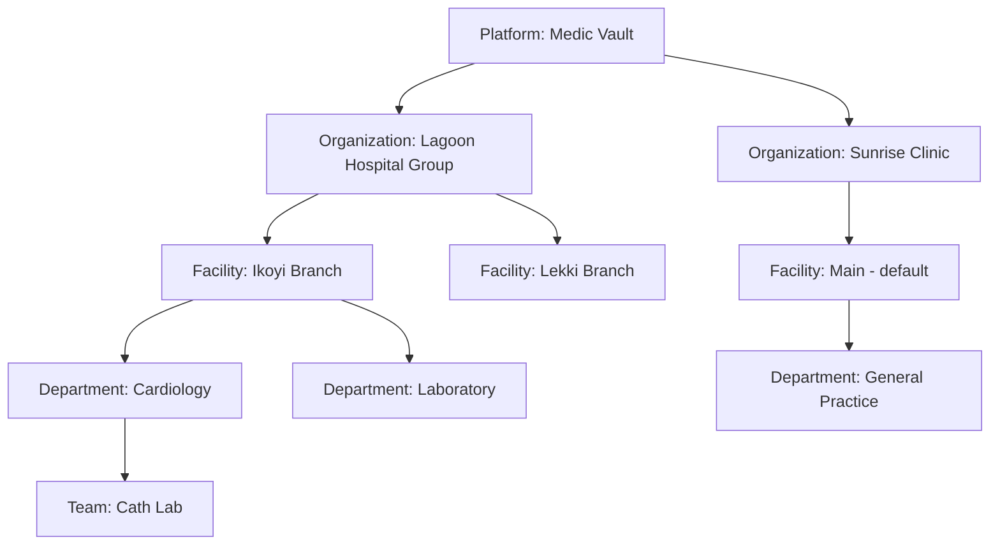

# Medic Vault Product Roadmap

**From a single-user demo to a multi-institution medical records platform.**

_Last updated: 2026-11-09_

---

## 1. Vision

Medic Vault is a workspace for medical institutions, run the way a CRM runs a company:

1. **One person signs up and creates an institution** (a hospital, clinic, lab or group). They become its **Owner**.
2. **The institution builds its structure:** facilities (branches), departments and teams.
3. **Staff join the institution** through an invite, an approved join request or their work email domain. Each person gets a role and a place in the structure.
4. **The institution builds its own database:** patients, records, files and notes. Every record belongs to the institution, and access follows the role and department.
5. **Everything is audited.** Who saw what, when, and why.
6. **Institutions can share outward** through **Public Medical Folders**: controlled, expiring and audited links for patients, partner institutions and the public (Phase 6).

Success looks like this: a new clinic can sign up, set up departments, invite ten staff, import its patient list and start working **in under 30 minutes, without talking to us**.

---

## 2. Where we are today (honest baseline)

### What's real

| Area | State |
| --- | --- |
| Auth | Firebase Auth (email/password + Google). Works in production. |
| Roles | One global role per user (`staff` / `admin` / `super_admin`) stored in Firestore `users/{uid}.role`. Users can't change their own role. |
| API | Express on Railway with helmet, a CSP, rate limiting, zod validation, structured logs and Sentry hooks. |
| Data | SQLite on a Railway volume. **Read-only** `GET /api/patients` and `GET /api/stats` (admins only), seeded with 50 demo patients. |
| Audit | An `audit_logs` table records `patients.list` and `stats.read`. |
| Ops | CI (lint, test, build), Vercel (front end) + Railway (API) auto-deploy from `main`, deployment docs. |
| Compliance docs | Retention, PHI-safe logging and encryption runbook (`COMPLIANCE_PHASE6_RUNBOOK.md`). |

### What's mock or browser-only (looks done, isn't)

| Screen / feature | Reality |
| --- | --- |
| Departments | Hardcoded list in `src/constants.ts` (Cardiology, Oncology, …). |
| Department folders | Mock data in `FolderDetailView.tsx`. |
| Add patient | Added to React state only; the extra details go to `localStorage`. Lost on another device, never reaches the server. |
| File upload | Files are read as base64 into **`localStorage`**. Nothing is uploaded. |
| Public Medical Folders | Stored in `localStorage` with demo folders. Share links are a toast only. |
| Activity & Audit | Made-up log entries generated in `ActivityAuditView.tsx`. The real `audit_logs` table isn't shown. |
| Roles & Permissions, Administration | Sidebar items with no screens behind them. |
| Add user, Emergency access | Forms only, with no backend. |
| Notifications | Static examples. |
| Profile picture | `localStorage`. |
| Data visibility | Only `super_admin` sees patients. Everyone else sees empty screens. |

### Structural gaps

- **No institution concept.** All data is global. This is the core thing to build.
- **No page addresses (URLs).** Navigation is a `switch` on React state, so refreshing loses your place, and pages can't be linked or bookmarked.
- **No write API.** The server can't create, update or delete anything except audit rows.
- **Storage won't scale.**
  - SQLite on one volume means one server, no concurrent writers and manual backups.
  - There's no object storage for files.
- **Two sources of truth for users:** Firestore for profiles and roles, SQLite for everything else.
- **1.09 MB JavaScript bundle**, with no code splitting.
- **`railway.json` is deprecated.** Migrate it before **2026-12-01**.

---

## 3. Target architecture

### 3.1 Tenancy model



- **Organization (institution).** The tenant: billing, settings, members and data all live here.
- **Facility.** A branch or site. Every organization gets one default facility, so small clinics never see this level until they add a second site. Building it into the data model now avoids a painful migration later.
- **Department → Team.** These are optional levels for access scoping and reporting.
- **Membership.** It links a user to an organization with a role and one or more department assignments. **A user can belong to several organizations**, for example a doctor who consults at two hospitals, and switches between them like workspaces.
- **Every clinical record carries `organization_id`**, and every query is scoped by it on the server. This is non-negotiable: one institution must never see another's data.

### 3.2 Roles and permissions

There are two layers:

- **Platform roles** (Medic Vault staff): `platform_admin`. These are kept separate from institution roles.
- **Organization roles** (per membership):

| Role | Typical person | Can do |
| --- | --- | --- |
| **Owner** | Founder / Medical Director | Everything, including billing, deleting the org and transferring ownership. At least one per org. |
| **Admin** | IT / Operations | Manage members, structure, settings and integrations. No clinical access unless also assigned clinically. |
| **Department Head** | HOD Cardiology | Manage their department's members and records, and approve access requests. |
| **Clinician** | Doctor | Read/write records in assigned departments, upload files, add notes. |
| **Nurse** | Nurse | Read records in assigned departments, add vitals and notes. Limited edits. |
| **Records Officer** | Medical records clerk | Create and import patients, manage files. No clinical notes. |
| **Auditor** | Compliance | Read-only access to audit logs and access reports. No patient content. |
| **Viewer** | Students, external reviewers | Read-only within the granted scope, usually time-limited. |

Implementation:
- Permissions are **strings** (`patients.read`, `patients.write`, `files.upload`, `members.invite`, `audit.read`, `folders.publish`, …).
- Roles are named bundles of permissions. Built-in roles ship first; **custom roles** follow in Phase 7.
- **Scope** = organization-wide or limited to specific departments.
- **Break-glass access.** In an emergency, a user can get time-limited access outside their scope by giving a reason. It's always audited and flagged for review. The `GrantEmergencyAccessModal` UI already exists for this.

### 3.3 Technology decisions (recommended)

| Concern | Today | Recommended | Why |
| --- | --- | --- | --- |
| Identity | Firebase Auth | **Keep Firebase Auth** | Works, and covers Google, email, MFA and later SAML/OIDC through Identity Platform. |
| App data | SQLite + Firestore (profiles) | **PostgreSQL** (Railway Postgres or Neon/Supabase) | Many-tenant relational data, concurrent writes, row-level security, managed backups, point-in-time restore. |
| Tenant isolation | none | `organization_id` on every table + **Postgres Row-Level Security** as a backstop | It's defended in two places: the code *and* the database. |
| Files | browser `localStorage` | **Object storage**: Cloudflare R2 or S3 (or Firebase Storage) with signed URLs | Files are large and private, need encryption at rest, and downloads must expire. |
| Migrations | inline `CREATE TABLE` | **Drizzle ORM + drizzle-kit** migrations | Type-safe queries in TS and versioned schema changes. |
| Email | none | **Resend** or Postmark | Invites, join approvals, alerts. |
| Front-end routing | `switch` on state | **React Router** (or TanStack Router) | Real URLs, deep links, refreshing keeps your place, browser back works. |
| Server data in UI | ad-hoc `fetch` | **TanStack Query** | Caching, loading/error states and refetching in one consistent pattern. |
| Billing (Phase 7) | none | **Paystack** and/or **Stripe** | Depends on the target market (see Decisions). |

Firestore would then be retired: profiles, memberships and roles move into Postgres, so the server has one source of truth.

### 3.4 Core data model (first cut)

```
users             (id = firebase uid, email, name, avatar_url, created_at)
organizations     (id, name, slug, type, country, logo_url, plan, created_by, created_at)
facilities        (id, organization_id, name, address, is_default)
departments       (id, organization_id, facility_id, name, parent_department_id?, created_at)
memberships       (id, organization_id, user_id, role, status[active|suspended], title, employee_id, joined_at)
membership_departments (membership_id, department_id)
invitations       (id, organization_id, email, role, department_ids, token_hash, invited_by, expires_at, accepted_at)
join_requests     (id, organization_id, user_id, message, status, decided_by, decided_at)
allowed_domains   (organization_id, domain, auto_role)              -- "anyone @lagoonhospital.ng can request to join"

patients          (id, organization_id, mrn, first_name, last_name, dob, sex, phone, email, status,
                   primary_department_id, created_by, created_at, updated_at, deleted_at)
patient_departments (patient_id, department_id)
encounters        (id, organization_id, patient_id, department_id, type, started_at, ended_at, clinician_id)
notes             (id, organization_id, patient_id, encounter_id?, author_id, body, created_at)
files             (id, organization_id, patient_id?, department_id?, folder_id?, storage_key, name, mime,
                   size_bytes, sha256, uploaded_by, created_at, deleted_at)
folders           (id, organization_id, department_id?, name, parent_folder_id?)

emergency_access  (id, organization_id, user_id, patient_id, reason, granted_by?, expires_at, reviewed_by, reviewed_at)
audit_events      (id, organization_id, actor_id, action, resource_type, resource_id, metadata, ip, user_agent, created_at)

-- Phase 6
public_folders    (id, organization_id, name, description, visibility[link|directory], expires_at, password_hash?,
                   allow_download, watermark, created_by, revoked_at)
public_folder_items (public_folder_id, file_id)
public_folder_views (id, public_folder_id, viewer_fingerprint, viewer_email?, viewed_at, ip)
```

---

## 4. Key user journeys

### J1: Create an institution (Owner)
1. Land on the site → **"Onboard your institution"**.
2. Sign up (email or Google) → verify the email.
3. **Setup wizard:**
   - Institution name, type (hospital, clinic, lab, pharmacy, other), country, size and logo.
   - Departments: pick from templates (General Practice, Cardiology, Pediatrics, Laboratory, Radiology, …) or add your own.
   - Invite the team: paste emails or upload a CSV, and pick a role and department for each.
   - Optional: import patients from CSV, or skip and explore with sample data clearly labelled **"Demo"**.
4. Land on the dashboard with a **setup checklist**, which disappears when complete.

### J2: Join an institution (Staff)
- **By invite:** email link → sign up or sign in → land inside the org with the role already set.
- **By domain:** sign up with `@lagoonhospital.ng` → "Lagoon Hospital Group uses Medic Vault. Request to join?" → an admin approves.
- **By search or code:** request access with an org code → admin approves.
- A signed-up user with no organization sees: **Create an institution** or **Join one**. They never see an empty dashboard.

### J3: Daily clinical work (Clinician)
Search a patient → open the profile (timeline of encounters, notes and files) → add a note or upload a result → it's audited automatically.

### J4: Administration (Admin)
Members list → change a role or department → suspend someone who has left (their access ends immediately) → review emergency-access events → export the audit log.

### J5: Share outward (Phase 6)
Select files → **Create public folder** → set expiry, password and download rules → copy the link → see who viewed it → revoke at any time.

---

## 5. Phased plan

Each phase ships to production behind the previous one and has a clear **"done when"**. Estimates assume one full-time developer with AI assistance. They're rough and meant for ordering work, not as promises.

### Phase 0: Foundations (1–2 weeks)
_Make the codebase able to support real, multi-tenant data._

- [ ] Migrate `railway.json` to `.railway/railway.ts` **(deadline: 2026-12-01)**.
- [ ] Add **React Router**, with a URL for every screen (`/app/:orgSlug/patients/:id`, …).
- [ ] Add **TanStack Query**, with one API client that sends the auth token and the active org.
- [ ] Provision **Postgres**. Add **Drizzle**, migrations and a seed script for demo data.
- [ ] Set up **object storage** (R2/S3): upload/download through short-lived signed URLs, with size and type limits.
- [ ] Mark everything mock as **"Demo data"** in the UI, or hide it, so nobody mistakes it for real data.
- [ ] Code-split the bundle: the landing page and the app load separately.
- [ ] Remove the leftover `data/medic-vault.db` from git and drop the unused Google Fonts (Inter/Outfit) if they're confirmed unused.

**Done when:** every screen has a URL, the API reads and writes Postgres through migrations, a file can be uploaded to and downloaded from object storage, and CI runs migrations against a test database.

### Phase 1: Institutions and membership (2–3 weeks)
_The core idea: one person creates an institution, and others join it._

- [ ] Tables: `organizations`, `facilities` (with a default), `memberships`, `invitations`, `join_requests`, `allowed_domains`.
- [ ] **Org context on every request.** The server resolves the active org from the URL slug or a header, checks membership and attaches `req.org` + `req.membership`. Add Postgres RLS policies as a backstop.
- [ ] **Setup wizard** (J1) and **no-org screen** (create or join).
- [ ] **Invitations:** email via Resend, accept flow, resend/revoke, 7-day expiry.
- [ ] **Join requests and domain auto-suggest** (J2).
- [ ] **Org switcher** in the sidebar for users with several memberships.
- [ ] Move user profile and role data from Firestore into Postgres, then retire Firestore. `scripts/manage-user.ts` becomes a platform-admin tool.
- [ ] Re-scope the existing patients API by `organization_id`. The 50 demo patients move into a "Demo Hospital" org.

**Done when:** two separate institutions can be created, each invites members, and **an automated test proves that org A can't read, list or guess any of org B's records** through any endpoint.

### Phase 2: Institution structure (1–2 weeks)
_Facilities, departments and teams, and who belongs where._

- [ ] CRUD for facilities and departments, with templates.
- [ ] Assign members to departments (many-to-many).
- [ ] **Structure page:** a tree/org-chart view of the institution, with member counts and department heads. This is the "Hierarchy" link on the landing page.
- [ ] Replace the hardcoded `DEPARTMENTS` constant with real data.
- [ ] **Members page** (Administration): search, filter by role/department, change role, suspend, remove, see last active.

**Done when:** an admin can model a two-branch hospital with five departments and assign staff, and the Departments screen shows only real data.

### Phase 3: Patient records core (3–4 weeks)
_The institution's actual database._

- [ ] Patients CRUD with validation, a **medical record number (MRN)** unique per org, duplicate detection (same name + date of birth) and soft delete.
- [ ] **CSV import** with column mapping, a preview, error rows and an undo window.
- [ ] **Patient profile:** demographics, departments, a **timeline** (encounters, notes, files), and status changes (admitted / outpatient / ICU / discharged).
- [ ] **Files:** upload to object storage, attach to patient/department/folder, preview PDFs and images, versioning, virus scanning (ClamAV or the provider's scanning).
- [ ] **Notes** and basic **encounters**.
- [ ] **Search:** fast patient search by name/MRN/phone across the org, respecting scope. Postgres full-text search to start.
- [ ] Department folders backed by real data (replace the `FolderDetailView` mock).
- [ ] Dashboard stats computed per org and scoped to what the viewer may see.

**Done when:** a records officer imports 1,000 patients from CSV, a clinician finds one in under 2 seconds and attaches a PDF, and nothing remains in `localStorage` except UI preferences.

### Phase 4: Access control and audit (2 weeks)
_Make "who can see what" visible, enforceable and reviewable._

- [ ] Permission strings and the built-in role bundles from §3.2, enforced in **one** server middleware (`requirePermission('patients.write', { departmentId })`).
- [ ] Department scoping: clinicians see only the patients in their departments.
- [ ] **Roles & Permissions** page: a read-only matrix of what each role can do (custom roles come in Phase 7).
- [ ] **Break-glass access:** request with a reason → time-limited access → flagged for the department head and auditor to review.
- [ ] **Real Activity & Audit:** the existing UI connected to `audit_events`, with filters (user, patient, action, date), CSV export and a per-patient "who accessed this record" view.
- [ ] Audit every read and write of patient data, invitations, role changes, exports and logins.
- [ ] **Access reviews:** a quarterly prompt for admins to confirm each member's access, as required by the compliance runbook.

**Done when:** a nurse can't open a patient outside their department without break-glass, and every view of that patient appears in the patient's access history.

### Phase 5: UX overhaul (2–3 weeks, overlaps Phases 3–4)
_Make it feel like a product people choose to use._

- [ ] **Design system pass:** shared tokens (colour, spacing, type), and shared Button / Input / Select / Modal / Table / EmptyState / Skeleton components. Replace one-off styles.
- [ ] **States everywhere:** loading skeletons, empty states with a next action, inline error messages, no `alert()` calls.
- [ ] **Forms:** one form library (React Hook Form + zod shared with the server), inline validation, dirty-state warnings.
- [ ] **Global search / command palette** (⌘K): patients, members, departments, actions.
- [ ] **Notifications:** real in-app notifications (invites, join requests, break-glass, shares expiring) plus an email digest.
- [ ] **Mobile:** the clinician flows (search → profile → note → upload from the camera) must work one-handed on a phone.
- [ ] **Accessibility:** keyboard navigation, focus states, labels, contrast (WCAG 2.1 AA).
- [ ] **Performance:** route-level code splitting, a target of < 250 KB initial JS for the app shell, lists that handle 10k+ rows.
- [ ] **Usability test:** five people from a real clinic attempt J1–J4 with no help. Fix the top issues.

**Done when:** a new clinic completes onboarding in under 30 minutes in a usability test, and Lighthouse scores ≥ 90 for accessibility and performance on the app shell.

### Phase 6: Public Medical Folders (2–3 weeks)
_Controlled sharing outside the institution. The details get their own spec before we start._

Starting proposal:
- [ ] **Link shares** (the private default): an org member bundles files into a folder → gets an unguessable link.
  - Options: expiry, password, optional recipient email with a one-time code, view-only vs download, watermark with the viewer's identity.
- [ ] **Public directory** (opt-in, later in the phase): institutions publish non-identifiable material such as research datasets, patient education and public-health notices. It's browsable from the landing page ("Explore public medical folders").
- [ ] **Safety rails:**
  - Publishing to the directory needs `folders.publish` and a second approver.
  - A PHI checklist before anything goes public.
  - Automatic expiry reminders.
  - One-click revoke.
- [ ] **Viewer analytics and audit:** every view and download is logged, and visible to the folder owner and auditors.
- [ ] Replace the `localStorage` implementation in `FoldersView` / `PublicFolderDetailView`.

**Done when:** a doctor shares three files with a patient through an expiring password link, the patient views them on a phone, and the view appears in the audit log. An expired or revoked link shows a clear message, never the files.

**Open questions for the spec:**
- Who is the main audience: patients, partner institutions or the public?
- Should patients get their own accounts eventually, i.e. a patient portal?
- What exactly counts as "public" for a medical institution in our target markets?

### Phase 7: Enterprise (ongoing, after launch)
- [ ] **SSO:** SAML/OIDC per organization (Firebase Identity Platform). Enforce SSO for a domain.
- [ ] **MFA** required by org policy.
- [ ] **Custom roles** and permission editing.
- [ ] **Multi-facility reporting** and an org-wide admin console for hospital groups.
- [ ] **Billing:** plans by seats + storage, a trial, invoices (Paystack/Stripe), usage limits.
- [ ] **Data export** (full org export) and **retention policies** per org, carrying out the runbook's retention rules.
- [ ] **Public API + webhooks**, and integrations with standards like **HL7 FHIR** for interoperability with other systems.
- [ ] **SCIM** user provisioning for large institutions.
- [ ] **Status page, SLAs, backups with tested restores** (the runbook says quarterly), and a **staging environment** on Railway.
- [ ] Data residency options, if required by customers or regulators.

---

## 6. Cross-cutting requirements (apply in every phase)

- **Tenant isolation tests:** every new endpoint gets a "cross-org access is denied" test.
- **Audit by default:** any read or write of patient data writes an audit event.
- **PHI-safe logging:** follow `COMPLIANCE_PHASE6_RUNBOOK.md`. No names, emails or clinical text in logs or Sentry.
- **Encryption:** TLS everywhere, encrypted database and storage, signed URLs that expire in ≤ 15 minutes.
- **Migrations are reversible** and run in CI against a scratch database.
- **Feature flags** for anything half-built, so `main` stays deployable.
- **Docs:** update `DEPLOYMENT.md` and this roadmap when a phase lands.

---

## 7. Decisions needed from you

| # | Decision | Options | Recommendation |
| --- | --- | --- | --- |
| D1 | Primary market / regulation | Nigeria (NDPA 2023), US (HIPAA), EU/UK (GDPR), several | Pick the first market now. It drives hosting region, vendor agreements (e.g. HIPAA BAAs), consent and retention rules. |
| D2 | Database | Postgres on Railway vs Neon vs Supabase | **Railway Postgres** to stay on one platform. Move to a managed provider with PITR and compliance certificates before handling real patient data. |
| D3 | File storage | Cloudflare R2 vs AWS S3 vs Firebase Storage | **R2** (no egress fees) unless D1 needs a specific certified provider. |
| D4 | Multi-org membership | allow a user in several orgs, or one only | **Allow several** (consultants, locums). It's cheap to support now and costly to add later. |
| D5 | Self-serve vs approved institutions | anyone can create an org, or we verify institutions first | **Self-serve with verification badges.** Anyone can start; publishing public folders requires a verified institution. |
| D6 | Pricing model | per seat / per facility / storage tiers / free tier | Decide before Phase 7. The data model doesn't depend on it. |
| D7 | Patient accounts | patients never log in vs a future patient portal | **Not in the first release**, but don't block it: patients live in their own table, linkable to a user later. |
| D8 | Brand of tenant | "Institution", "Organization" or "Workspace" in the UI | **"Institution"** in the UI, `organization` in code. |

---

## 8. Risks

| Risk | Mitigation |
| --- | --- |
| Data leaking between institutions | Org scoping in middleware + Postgres RLS + an automated cross-tenant test suite. |
| Handling real patient data before compliance is ready | Keep production as **demo/pilot only** until Phase 4 is done and D1 is decided. Show a visible "Pilot – do not upload real patient data" banner until then. |
| Scope creep (EHR features) | Medic Vault is a **records and file vault with access control**, not a full EHR. Prescribing, billing patients and lab orders are out of scope unless deliberately added. |
| Single developer, large scope | Ship phase by phase. Each phase is usable on its own. |
| Vendor lock-in (Firebase, Railway) | Auth is abstracted behind the server. Postgres and S3-compatible storage are portable. |

---

## 9. Suggested order and milestones

| Milestone | Phases | Outcome |
| --- | --- | --- |
| **M1: Foundations** | 0 | Real URLs, Postgres, file storage. |
| **M2: Multi-tenant alpha** | 1 + 2 | Institutions can sign up, invite staff and model their structure. |
| **M3: Usable records** | 3 + 5 (first half) | Institutions run their patient database on it. **Pilot with 1–2 friendly clinics.** |
| **M4: Trustworthy** | 4 + 5 (second half) | Access control and audit are complete, and the UX is polished. Ready for paying institutions. |
| **M5: Sharing** | 6 | Public Medical Folders. |
| **M6: Enterprise** | 7 | SSO, billing, integrations, hospital groups. |

**Next step:** confirm decisions D1–D5. Then Phase 0 starts with the `railway.json` migration (time-sensitive) and React Router.
